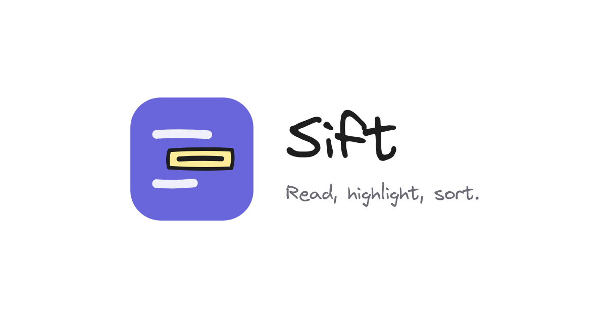

# Sift Reader

Live: https://ledtque.github.io/sift/

Read PDFs, highlight what matters, and sort your highlights by hand on a sketchy whiteboard.

Everything runs in the browser. PDFs, highlights and boards are stored on your own device (IndexedDB) and are never uploaded anywhere. Use **⋯ → Backup & restore** now and then to save a backup file.

## Keeping your library safe

PDFs are copied into the browser when you add them, so deleting the original file from your computer doesn't affect Sift.

- **Automatic backup (Chrome, Edge):** open Backup & restore (the "Turn on backup" button above the reader) and choose a folder. After every change Sift writes `sift-data.json`, each PDF in `pdfs/` and each board image in `images/`. `history/` keeps the last copy of every day (for 180 days, and the first of each month for good) and, in `history/hourly/`, the first copy of each hour for the last two days. `notes/` has every board as a Markdown file, with all of that PDF's highlights in page order, so the work can be read without Sift. Pick a folder inside Google Drive, OneDrive, Dropbox or iCloud Drive to keep it in the cloud as well.
- **Earlier versions:** Sift also keeps copies inside the browser: when it opens, every ten minutes while something changes, and before anything big is removed (erasing, deleting a board, removing a PDF, restoring). Backup & restore → *Earlier versions* goes back to one; what you have at that moment is kept as a version first, so going back can be undone too. The 24 newest are kept, and the last one of each day for 60 days.
- **New computer or browser:** Backup & restore → *Restore from a backup folder*, and pick the same folder.
- **Any browser:** *Save full backup file* makes one file with everything, PDFs included. Without a backup folder, Sift reminds you now and then.
- **Brave:** automatic backup needs `brave://flags/#file-system-access-api` set to Enabled. If Brave clears site data when it closes, add this site as an exception, or the library is cleared each time.
- **One tab at a time:** if Sift is opened in a second tab, that tab waits and offers to take over, so two tabs never save over each other.
- **Save problems are shown:** if the browser refuses to save (for example when its storage is full), a notice says so, Sift keeps trying, and the work stays on screen until it is saved.
- **Removing a PDF** can be undone, and the file stays stored for 30 days so an earlier version can bring it back.
- Your data lives with the site's address. If the address ever changes, move the library with a backup folder or file.
- The site works offline once it has been opened, and can be installed as an app from the browser's address bar.

## Reading

- Select text and press **1–4** (or pick a color) to highlight it. The highlight lands on the PDF's board right away, where you can see it.
- **Eraser** (or **E**): click a highlight, or drag across several, to remove them along with their cards on the board. **Undo** on the notice, or Ctrl+Z, brings them back. Esc puts the eraser away.
- **Contents** (list icon) jumps through the PDF's own table of contents, when it has one.
- **Ctrl+F** finds text in the PDF, with next/previous and every match marked on the page.
- **Ctrl + scroll** zooms the PDF. Each PDF remembers its zoom and the page you stopped on.
- Click the PDF's name to rename it. Its board takes the same name.

## The board

Every PDF has its own board. Cards show the full highlight; double-click a card to edit its text (the PDF keeps the original), and drag the handle on its right edge to change its width. Selecting something opens the style panel on the left of the board: color, font size, bold and italic, alignment, frame on or off, stroke width for rectangles, layer order, duplicate and delete.

**Images:** paste a screenshot (Ctrl+V), drop image files onto the board, or press **I**. Drag the handle on an image's right edge to resize it. Images are part of the automatic backup and the backup file.

**Minimap:** the small map in the bottom-right corner shows the whole board and where you are. Click or drag on it to move around; press **M** to hide or show it.

**Layouts:** the switch at the top right shows the PDF only, the PDF and the board side by side, or the board only (**Alt+1 / Alt+2 / Alt+3**). Highlights you make with the board hidden are still added to it. **F** puts the whole window in full screen, whatever the layout. **Ctrl+F** over the board finds cards. **⋯ → Export as PNG** saves the board as an image (only the selected cards, if any are selected), and **Copy as PNG** puts it on the clipboard. **⋯ → Export as Markdown** saves the board as notes for Obsidian, Notion and the like. Press **?** for all shortcuts.

| Key | Action |
| --- | --- |
| V | Select and move |
| H, or hold Space | Move around the board |
| T | Note: click to write |
| R | Rectangle: drag to draw |
| I | Add an image (or paste / drop one) |
| Double-click | Edit a card, or add a note on empty space |
| A or Ctrl+A | Select everything |
| Shift + click | Add to or remove from the selection |
| Ctrl+C / Ctrl+X / Ctrl+V | Copy, cut, paste (pasting text makes a note) |
| Ctrl+D | Duplicate |
| Ctrl+B / Ctrl+I | Bold, italic |
| Ctrl+Shift+] / Ctrl+Shift+[ | Bring to front, send to back |
| Delete | Remove from the board (highlights stay in the PDF) |
| Ctrl+Z / Ctrl+Shift+Z | Undo / redo |
| Ctrl+= / Ctrl+- / Ctrl+0 | Zoom in, out, 100% |
| Shift+1 | Fit everything |
| M | Show or hide the minimap |
| Ctrl+Shift+E | Export as PNG |
| Shift+Alt+C | Copy as PNG |
| Arrow keys | Nudge selection (Shift for bigger steps) |
| F | Full screen, and back |
| Alt+1 / Alt+2 / Alt+3 | PDF only, both, board only |
| Esc | Clear selection |

## Hosting

This is a static site: `index.html` plus the `lib/` folder. It works on GitHub Pages, Netlify, Cloudflare Pages or any static host. No build step.

## Third-party parts

- [PDF.js](https://mozilla.github.io/pdf.js/) 3.11.174 by Mozilla, Apache License 2.0 — see `lib/PDFJS-LICENSE.txt`.
- The handwriting font is Virgil by Ellinor Rapp, released under the SIL Open Font License 1.1 — see `FONT-LICENSE.txt`. It is embedded in `index.html`.
- The interface font, Assistant, loads from Google Fonts.
